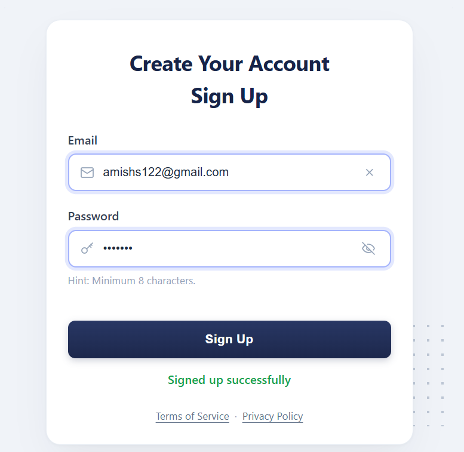
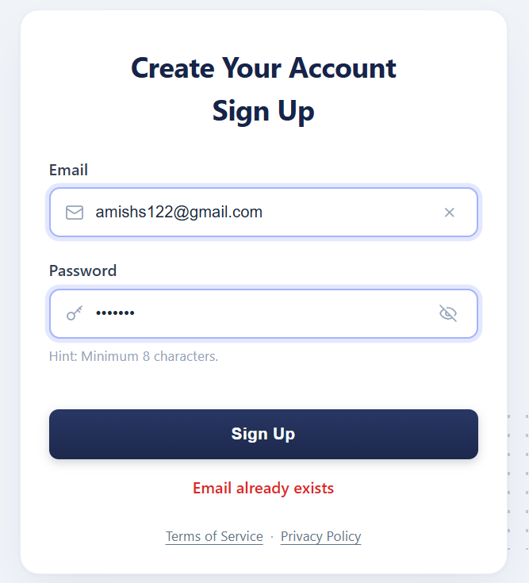
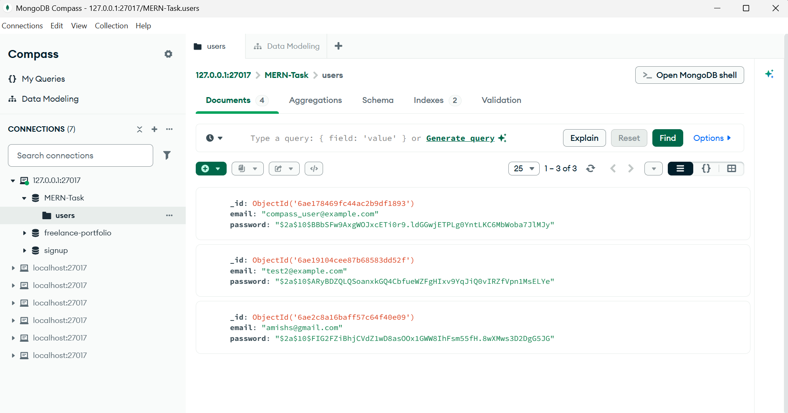

# Sign Up Process

Sign Up process using React, Express.js, REST API and MongoDB.

## Tech Stack

- React
- Vite
- CSS
- Node.js
- Express.js
- MongoDB
- Mongoose
- bcryptjs

## Project Structure

```
task2/
├── .gitignore
├── README.md
├── client/
│   ├── index.html
│   ├── package-lock.json
│   ├── package.json
│   ├── vite.config.js
│   └── src/
│       ├── App.jsx
│       ├── main.jsx
│       └── style.css
├── screenshots/
│   ├── image.png
│   ├── image-copy.png
│   └── image-copy-2.png
└── server/
    ├── package-lock.json
    ├── package.json
    └── server.js
```

## How to Run

MongoDB must be running on `mongodb://127.0.0.1:27017`. Data is stored in database `MERN-Task`, collection `users`, with passwords hashed using bcrypt.

### Server

```bash
cd server
npm install
npm start
```

### Client

```bash
cd client
npm install
npm start
```

## API Endpoints

- `POST /signup` - Register a new user with email and hashed password.

## Screenshots


The sign-up form shows a submitted email address with the message "Signed up successfully" displayed in green. This confirms successful account creation through the front end.


The sign-up form displays an entered email address with the error message "Email already exists" in red. This proves that duplicate email submissions are handled and rejected.


MongoDB Compass displays the `users` collection within the `MERN-Task` database showing documents with `email` and hashed `password` fields. This verifies that registered user data is saved in MongoDB with bcrypt password encryption.
